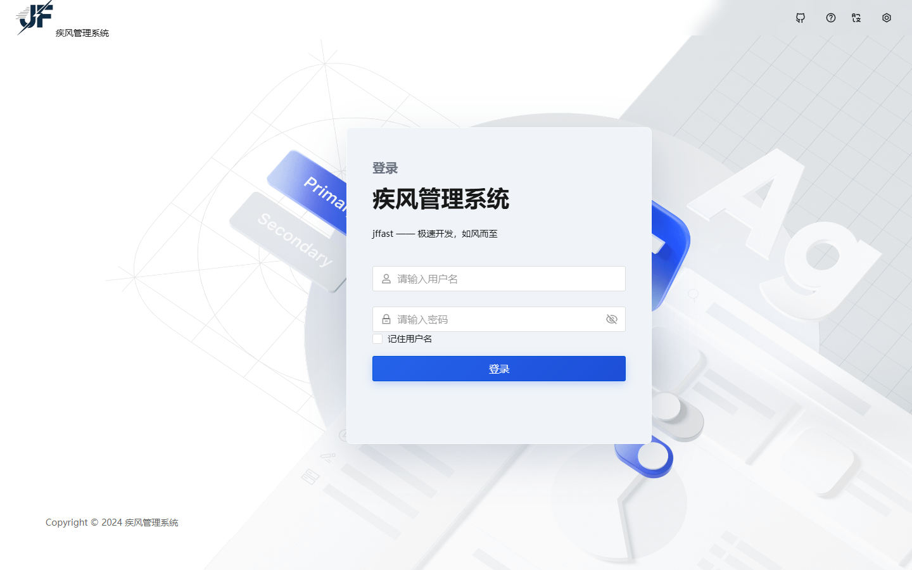
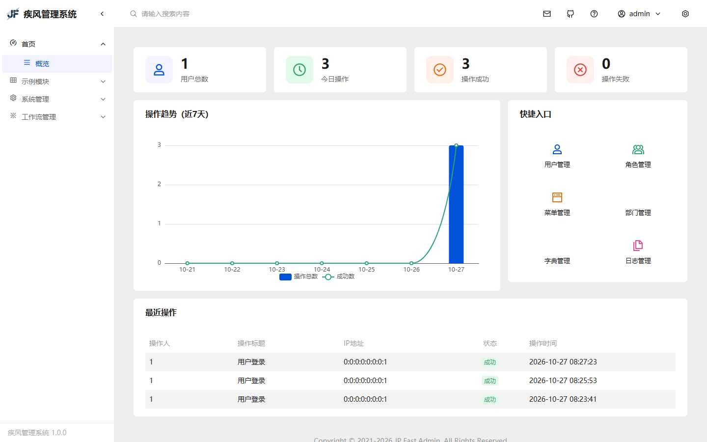
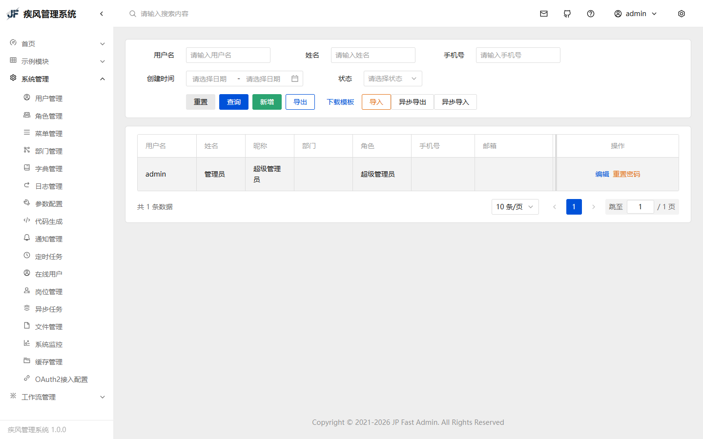
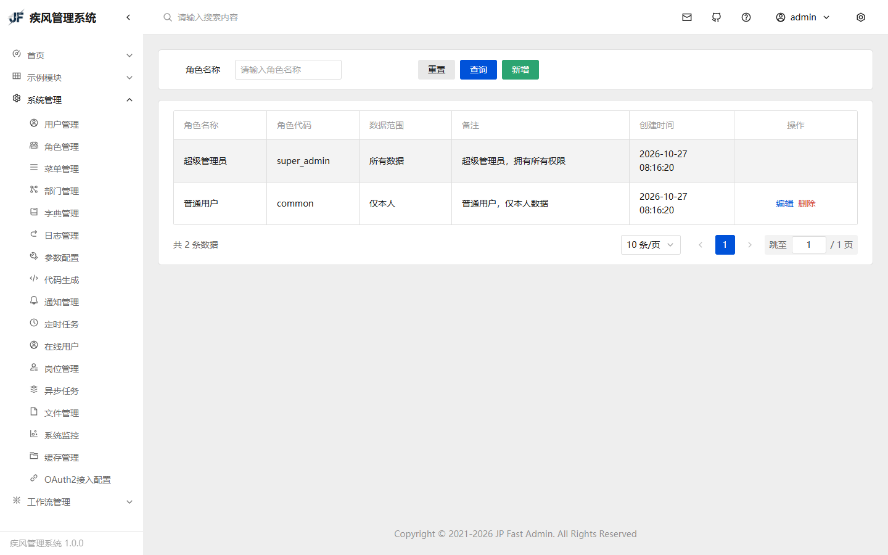
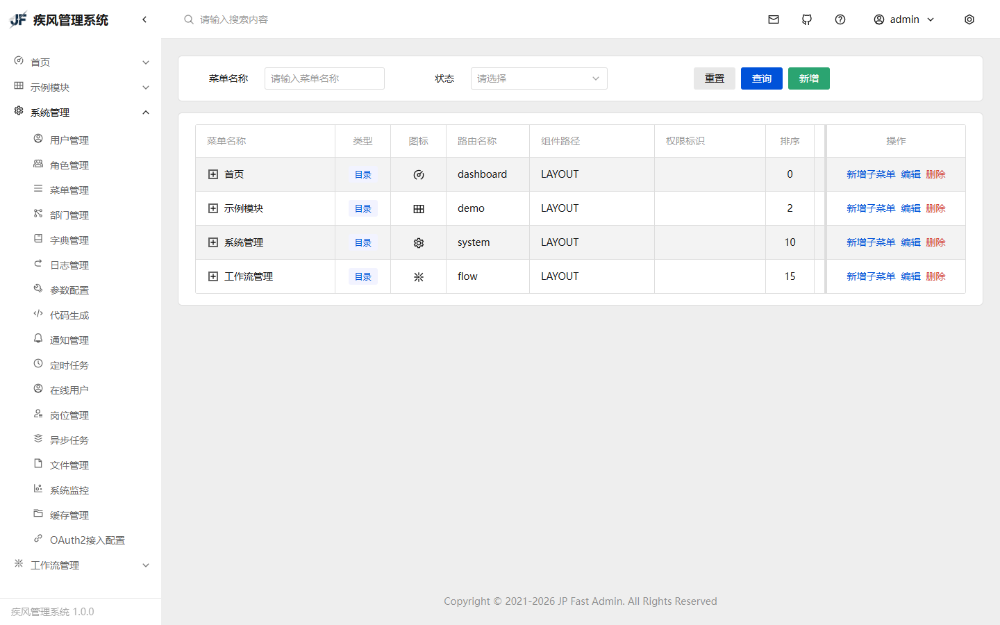
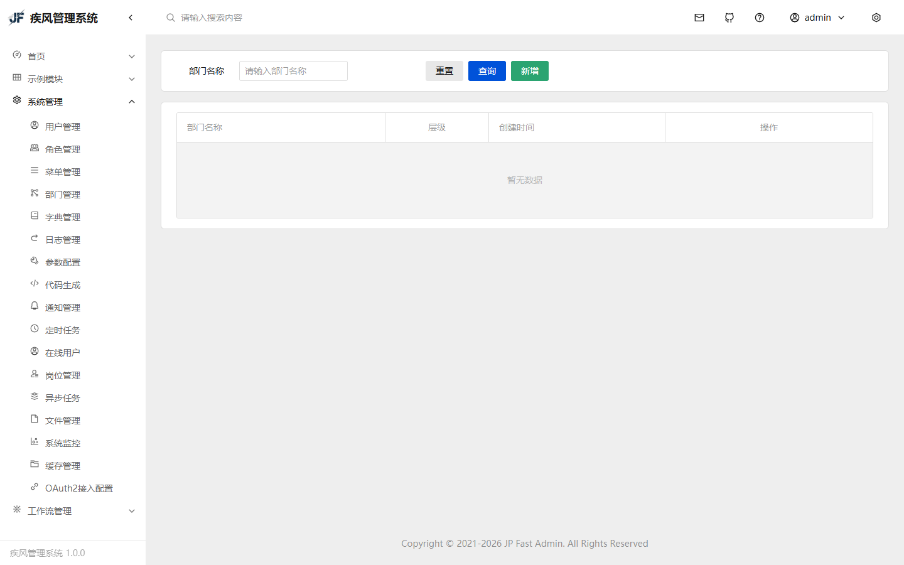
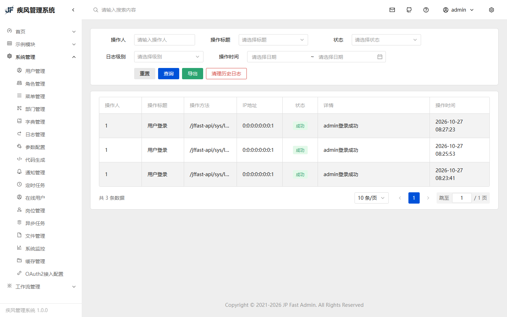
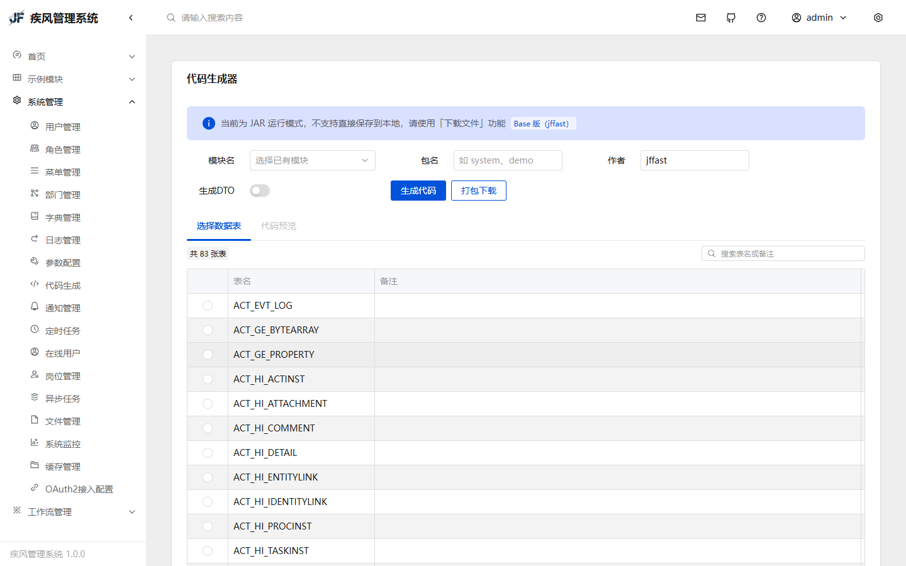
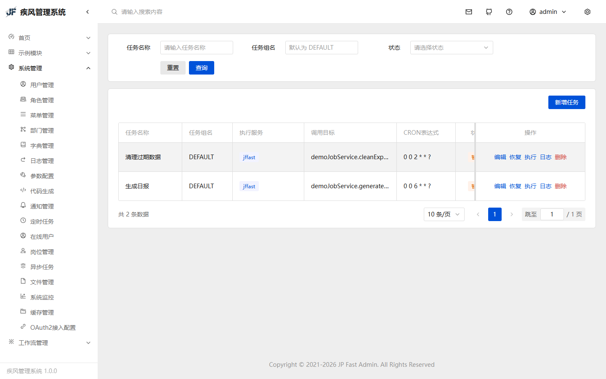

# 🌪️ 疾风 (jffast)

> 极速开发，如风而至 —— 基于 Spring Boot 的一站式后台管理框架


[快速开始](#快速开始) · [功能特性](#功能特性) · [模块说明](#模块说明) · [配置指南](#配置指南) · [部署指南](deploy/README.md) · [开发规范](docs/开发规范.md)

---

## 🌟 项目简介

疾风（jffast）是一套**开箱即用**的企业级快速开发框架，采用「**可插拔 Starter**」设计，每个功能模块独立封装，按需引入，零配置即可生效。

### 为什么选择疾风？

| 特性                  | 说明                                                     |
| ------------------- | ------------------------------------------------------ |
| 🧩 **可插拔 Starter**  | 12 个独立 Starter，引入即用，不需要的不引入                            |
| 📐 **约定优于配置**       | 统一 CRUD 路径、分页参数、响应格式，团队零沟通成本                           |
| 🔒 **安全内建**         | RSA 加密 + BCrypt 存储 + XSS 过滤 + 接口限流 + 分布式锁              |
| ⚡ **极速开发**          | BaseEntity + BaseService + BaseController 三件套，5 分钟一个模块 |
| 🎨 **前端工厂模式**       | createCrud + useTable + useForm，一个模块 2 个文件搞定           |

### 与同类框架对比

| 特性               |   疾风 jffast  |     RuoYi-Vue     | RuoYi-Vue-Plus |      Pig     |    JeecgBoot    |
| ---------------- | :----------: | :---------------: | :------------: | :----------: | :-------------: |
| Spring Boot 4.x |   ✅ 4.1.1    |     ✅ 4.x 分支¹     |    ✅ 3.5.14    |   ✅ 3.5.12   |    ✅ 3.x 分支²    |
| JDK 21 + 虚拟线程    |       ✅      |      ❌ (17+)      |        ✅       |    ❌ (17)    |      ❌ (17)     |
| 可插拔 Starter      |       ✅      |         ❌         |        ✅       |       ✅      |        ❌        |
| 前端 CRUD 工厂       | ✅ createCrud |         ❌         |        ❌       |       ❌      |      ✅ 低代码      |
| 轻量级认证            |  ✅ Sa-Token  | ❌ Spring Security |   ✅ Sa-Token   |   ❌ OAuth2   |     ❌ Shiro     |
| 多租户字段隔离⁵          |   ⚙️ 预留⁵   |         ❌³        |        ✅       |       ✅      |        ✅        |
| 数据权限             |     ✅ 5级     |        ✅ 5级       |      ✅ 5级      |       ✅      |        ✅        |
| 开源协议             | ✅ Apache 2.0 |       ✅ MIT       |  ✅ Apache 2.0  | ✅ Apache 2.0 |    ⚠️ 含商业限制⁴    |
| 代码生成             |    ✅ 开源版内置   |      ✅ 开源版内置      |     ✅ 开源版内置    |    ✅ 开源版内置   |      ✅ 低代码      |
| 前端框架             | TDesign Vue3 |    Element Plus   |  Element Plus  | Element Plus | Ant Design Vue3 |

¹ RuoYi-Vue master 分支已升级 Spring Boot 4.x，同时维护 2.x/3.x 分支；² JeecgBoot 主分支仍为 Spring Boot 2.x，3.x 为独立分支；³ RuoYi 原版无多租户，Plus 版才有；⁴ JeecgBoot 开源版可商用，但存在商业版分支及授权限制；⁵ 本开源版提供 `sys_tenant` 表结构与 `jffast.mybatis.tenant.*` 配置位，运行时字段隔离拦截需自行实现。

---

## 📦 功能特性

### 系统截图

| 登录页 | 仪表盘 |
| :-: | :-: |
|  |  |

| 用户管理 | 角色管理 |
| :--: | :--: |
|  |  |

| 菜单管理 | 部门管理 |
| :--: | :--: |
|  |  |

| 操作日志 | 代码生成 |
| :--: | :--: |
|  |  |

| 定时任务 |
| :--: |
|  |

### 后端功能

- ✅ **认证登录** — Sa-Token 轻量级认证，支持多端登录、Token 续期
- ✅ **RBAC 权限** — 用户/角色/菜单/按钮四级权限控制
- ✅ **用户管理** — 用户 CRUD、密码管理、头像上传
- ✅ **角色管理** — 角色 CRUD、权限分配
- ✅ **菜单管理** — 树形菜单、按钮权限
- ✅ **部门管理** — 树形部门结构
- ✅ **岗位管理** — 岗位 CRUD、岗位编码唯一校验
- ✅ **字典管理** — 字典类型 + 字典项
- ✅ **操作日志** — @SLog 注解自动记录操作，支持日志级别筛选和清理
- ✅ **接口文档** — springdoc-openapi 自动生成
- ✅ **XSS 过滤** — 可配置排除 URL
- ✅ **TraceId 链路** — MDC 传递，日志追踪
- ✅ **文件上传** — 本地 / MinIO / 阿里云 OSS / 腾讯云 COS 多云可切换，支持文件类型白名单和大小限制
- ✅ **文件管理** — 上传记录自动登记（`sys_file`）、分页查询 / 下载 / 批量删除
- ✅ **Excel 导入导出** — FastExcel，用户/日志导入导出、导入模板下载、异步导入导出
- ✅ **异步任务** — 导入/导出任务进度跟踪、结果文件下载、失败明细（`sys_task`）
- ✅ **通知通道** — 站内信 + 邮件/短信通道（邮件走 `spring.mail`，短信走 HTTP 网关）
- ✅ **接口限流** — @RateLimit 令牌桶算法（Resilience4j），配置见 [`docs/api-rate-limiting.md`](docs/api-rate-limiting.md)
- ✅ **分布式锁** — @DistributedLock Redis 锁
- ✅ **防重复提交** — @Idempotent 注解，已接线各保存类接口
- ✅ **多数据源** — @DS 注解动态切换数据源（`jffast.datasource.dynamic.*`，默认关闭）
- ✅ **密码安全** — 前端 RSA 加密 + 后端 BCrypt 存储
- ✅ **防暴力破解** — 登录失败计数 + 账号锁定（默认 15 分钟自动解锁，严格模式 30 分钟，支持管理员手动解锁）
- ✅ **代码生成器** — 可视化代码生成，根据表结构自动生成前后端 CRUD 代码
- ✅ **定时任务** — Quartz 调度引擎，支持任务 CRUD/暂停/恢复/立即执行/执行日志
- ✅ **工作流引擎** — Flowable 8 BPMN 2.0，支持流程部署/发起/审批/历史，审批人 SPI 解析（user/role/dept/initiator），代码模式设计器
- ✅ **国际化** — 框架级消息国际化（Accept-Language / `MessageUtil`）；页面文案以中英词典逐步覆盖，非全量硬编码替换
- ✅ **系统监控** — JVM/OS/磁盘实时监控接口
- ✅ **缓存管理** — Redis 信息查看、缓存键值管理

> **关于验证码**：登录验证码按失败次数自动启用——同一账号连续输错 2 次后，登录页自动出现图形验证码（`/sys/needCaptcha` 判定 + `/sys/getCode` 取图），无需额外配置。
>
> **文件存储已知限制（jffast-starter-file）**：本地存储上传路径强制追加时间戳子目录（落盘路径不可精确预测，需要确定性路径请自建 `XxxFileService`）；`delete()` 仅支持单文件；本地存储根目录 `jffast.file.storage.local.path` 同时决定上传根与 `/upload/**` 静态映射，两处必须一致，改配置时请整体替换。
> 另有一条**安全边界**要记住：`/upload/**` 在免登录白名单里，所以存储根内的每个文件都对外公开可下载（这是「头像/附件要能被 `` 直接引用」的代价）。因此服务端生成的敏感文件（如异步导出的用户表格）必须写在根目录之外——`jffast.system.task.file-dir` 默认 `./task-files`，配成根内子目录会启动失败。
>
> **数据权限 / 社交登录边界（Base）**：Base 内置 **5 级**数据权限（全部 / 本级及下 / 本级 / 仅本人 / 自定义，`@DataPermission` 注解触发；拦截器由 `jffast.mybatis.data-scope.enabled` 控制，缺省即装配）与 GitHub/Gitee/Microsoft 个人 OAuth2 登录。
>
> **异步任务结果文件（单实例）**：导入导出任务的中间文件写在**文件存储根之外**的工作目录 `./task-files`（`jffast.system.task.file-dir`，可经 `JFFAST_TASK_FILE_DIR` 覆盖）——存储根经 `/upload/**` 免登录静态映射，敏感产物落在里面等于公开下载，配错会启动失败。任务归属按 `create_by` 隔离。默认形态只适用于**单实例**：多实例部署必须把该目录挂成共享卷或改用对象存储，否则在另一实例下载会返回「文件不存在或已清理」。

### 前端功能

- ✅ **登录页** — 暗黑/明亮双主题
- ✅ **仪表盘** — 系统概览面板
- ✅ **系统管理** — 用户/角色/菜单/部门/岗位/字典/日志/文件管理/异步任务
- ✅ **系统监控** — CPU/内存/磁盘/JVM 实时监控
- ✅ **缓存管理** — Redis 信息查看、缓存清理
- ✅ **暗黑模式** — TDesign 主题切换
- ✅ **国际化** — 中英文切换（`shared/src/locales` 词条全量，`common.*` / `pages.<域>.<页面>.*` 命名，随语言即时切换）
- ✅ **全局水印** — 登录后叠加「应用名 + 用户名 + 时间」水印，防截图泄露
- ✅ **移动端适配** — 手机/平板断点自适应（侧边栏抽屉、顶栏压缩、内容横向滚动）
- ✅ **多标签页** — 标签页导航
- ✅ **面包屑** — 路由面包屑

---


## 🧩 模块说明

```
jffast/
├── jffast-bom/                    版本管理（BOM）
├── jffast-common/                 基础层
│   ├── BaseEntity                 实体基类（id/tenantId/createBy/updateBy...）
│   ├── BaseService                服务基类（数据权限/登录用户）
│   ├── BaseController             控制器基类
│   ├── R<T>                       统一响应封装
│   ├── LoginUtil                  登录工具（反射解耦）
│   └── BusinessException          业务异常
├── jffast-starters/               Starter 聚合模块
│   ├── jffast-starter-mybatis/    数据库 Starter
│   │   ├── 分页插件                自动配置（MySQL）
│   │   ├── 乐观锁插件              自动配置
│   │   ├── 自动填充                createBy/updateBy/createTime/updateTime
│   │   ├── 数据权限                jffast.mybatis.data-scope.enabled
│   │   └── 动态数据源              @DS 注解（jffast.datasource.dynamic.enabled，默认关闭）
│   ├── jffast-starter-web/        Web Starter
│   │   ├── 全局异常处理            自动配置
│   │   ├── Jackson 全局配置        日期/空值/时区
│   │   ├── springdoc 接口文档       自动配置
│   │   ├── XSS 过滤               jffast.web.xss.enabled
│   │   └── TraceId 链路           jffast.web.trace-id.enabled
│   ├── jffast-starter-security/   安全 Starter
│   │   ├── Sa-Token 认证          自动配置
│   │   ├── @RateLimit 限流        Resilience4j 令牌桶
│   │   ├── @DistributedLock 分布式锁  Redis SETNX
│   │   └── @Idempotent 防重复提交  保存类接口幂等拦截
│   ├── jffast-starter-redis/      缓存 Starter
│   │   └── RedisUtil             Redis 操作工具
│   ├── jffast-starter-log/        日志 Starter
│   │   └── @SLog                 操作日志注解
│   ├── jffast-starter-file/       文件存储 Starter
│   │   ├── LocalFileStorageService  本地存储
│   │   ├── MinIOFileStorageService  MinIO 存储
│   │   └── AliyunOss / TencentCosFileStorageService  阿里云 OSS / 腾讯云 COS
│   ├── jffast-starter-excel/      Excel Starter
│   │   └── FastExcel             导入导出
│   ├── jffast-starter-job/        定时任务 Starter
│   │   ├── Quartz 调度            自动配置 + JDBC 持久化
│   │   └── @JfFastJob             自定义任务注解
│   ├── jffast-starter-flowable/  工作流 Starter
│   │   ├── Flowable 8 引擎        BPMN 2.0 流程引擎
│   │   ├── FlowService            门面封装 Repository/Runtime/Task/History
│   │   └── AssigneeResolver       审批人解析 SPI 接口
│   └── jffast-starter-social/     社交登录 Starter
│       └── OAuth2                GitHub/Gitee/Microsoft 第三方登录
│   └── jffast-starter-oauth2-client/  OAuth2 客户端 Starter
│       └── 调用第三方                client_credentials/authorization_code + 内置 GitHub/Gitee/Microsoft
│   └── jffast-starter-demo-mode/  演示模式 Starter
│       └── DB 写短路 + 文件/任务副作用拦截（jffast.demo-mode.enabled，默认关闭）
├── jffast-biz/                业务模块聚合模块
│   ├── jffast-system/             系统管理模块
│   │   ├── SysUser/SysRole/SysMenu  用户/角色/菜单
│   │   ├── SysDept/SysDict/SysLog   部门/字典/日志
│   │   ├── SysPost/SysTask          岗位/异步任务（导入导出）
│   │   ├── SysSafe                 安全策略
│   │   ├── SysNotification          通知管理
│   │   ├── SysJob/SysJobLog         定时任务管理
│   │   └── CodeGenController        代码生成器
│   ├── jffast-flow/               工作流业务模块
│   │   ├── WfCategory              流程分类
│   │   ├── WfProcessController     流程定义/部署/实例
│   │   ├── WfTaskController        任务管理（待办/签收/审批/转办）
│   │   ├── WfHistoryController     历史查询（已办/审批记录）
│   │   └── JfFastAssigneeResolver  审批人解析（role/dept → userIds）
│   ├── jffast-demo/               示例业务模块（用户模板）
│   └── jffast-ai/                 AI 知识库模块
│       ├── AiKnowledgeBase         知识库
│       ├── AiDocument              文档
│       ├── AiConversation          对话与消息
│       └── （仅存储管理，不含大模型调用）
├── jffast-boot/                   可运行应用
└── sql/                           SQL 脚本
```

---

## 🚀 快速开始

### 环境要求

| 依赖      | 版本     |
| ------- | ------ |
| JDK     | 21+    |
| Maven   | 3.9+   |
| MySQL   | 8.0+   |
| Redis   | 7.0+   |
| Node.js | 22.22.1+（推荐 24 LTS） |

### 1. 克隆项目

```bash
git clone https://github.com/summerZstar/jffast.git
cd jffast
```

### 1.5 快速体验（Docker，可选）

如已安装 Docker，可一键启动 MySQL + Redis，免去本地安装：

```bash
docker compose up -d
# 等待约 10 秒后，按下方「2. 初始化数据库」的完整清单顺序导入 SQL
# （此处不重复列举，避免两处清单日后漂移；缺 sys_post / sys_task / sys_file /
#   flow_sql 等文件会表现为「菜单缺失 / Unknown column」）
```

> 之后可直接跳到「4. 编译运行」步骤，环境变量使用默认值即可（MYSQL_HOST=127.0.0.1, MYSQL_USER=root, MYSQL_PASSWORD=test1234, REDIS_HOST=127.0.0.1, REDIS_PASSWORD=test1234）。
>
> **生产部署**：后端镜像 `jffast-boot` 与前端镜像 `jffast-web` 是两个独立镜像（前端在 jffast-ui 仓库构建）。
> Docker 单容器、Docker Compose 全量编排、Kubernetes + Helm Chart、K8s 原生 Manifests、
> 「只取镜像自己写编排」五种方式见 [部署指南](deploy/README.md)。

### 2. 初始化数据库

```sql
-- 创建数据库
CREATE DATABASE jffast DEFAULT CHARACTER SET utf8mb4 COLLATE utf8mb4_general_ci;

-- 导入表结构（系统表 + Quartz 定时任务表）
SOURCE sql/system_sql.sql;

-- 备注：sql/quartz.sql 与 system_sql.sql 内 QRTZ_*段幂等重复，只跑本文件即可；quartz.sql 是已有库独立补表入口，新建库可不跑

-- 导入工作流引擎表（Flowable，**必须导入**）：引擎在启动时就会初始化，
--    「schema 已存在」的判断却**忽略当前库** —— 同一 MySQL 实例里别的库有 ACT_GE_PROPERTY
--    就会走 upgrade 分支，本库没有表即报 Table 'xxx.act_ge_property' doesn't exist
--    （与是否真的用到工作流无关。本文件是逐条 create table，非幂等，务必在首次启动前导入）
SOURCE sql/flowable_schema/flowable_mysql_all.sql;

-- 导入初始数据（菜单/角色/用户/字典等）
SOURCE sql/system_init_data.sql;

-- 导入岗位管理（sys_post 表 + 「系统管理→岗位管理」菜单；幂等可重复执行）
SOURCE sql/sys_post.sql;

-- 导入异步任务（sys_task 表 + 「系统管理→异步任务」菜单；幂等可重复执行；
--    使用异步导入/导出功能时必须导入）
SOURCE sql/sys_task.sql;

-- 导入文件管理（sys_file 表 + 「系统管理→文件管理」菜单；幂等可重复执行；
--    使用文件管理功能时必须导入）
SOURCE sql/sys_file.sql;

-- 导入通知模板表（「通知管理→模板」页面依赖；菜单与按钮权限在 system_init_data.sql 中
--    已存在，缺这两张表会在打开模板页时报 Unknown table；脚本幂等可重复执行）
SOURCE sql/sys_notification_template.sql;

-- 导入工作流业务表（流程分类/流程定义业务扩展等，使用「工作流」功能时必须导入）
SOURCE sql/flow_sql.sql;

-- （可选）社交登录绑定表，仅使用社交登录功能时需要
-- SOURCE sql/social_bind.sql;

-- （可选）示例模块表，仅使用「示例管理」(demo) 功能时需要
SOURCE sql/demo_example.sql;

-- （可选）请假申请示例表
SOURCE sql/demo_leave_application.sql;

-- （可选）租户隔离示例表
SOURCE sql/demo_tenant_example.sql;

-- （可选）示例模块菜单 + 示例定时任务（两条都**默认暂停** status=0；
--    导入后到「系统管理 → 定时任务」点启用即可。不导入则前端没有「示例模块」目录）
SOURCE sql/demo_init_data.sql;

-- （可选）AI 知识库模块表（AI 中心：知识库/文档/对话）
SOURCE sql/ai_knowledge.sql;
```

> **SQL 文件说明**：
>
> - `system_sql.sql`：系统表结构 + Quartz 定时任务表
> - `flowable_schema/flowable_mysql_all.sql`：Flowable 工作流引擎表（**必须导入**，且要在首次启动前导入）。引擎启动即初始化，而它判断「schema 已存在」时**忽略当前库**：同一 MySQL 实例里任意库有 `ACT_GE_PROPERTY` 就走 `upgrade` 分支，本库缺表即以 `Table 'xxx.act_ge_property' doesn't exist` 启动失败 —— 与是否真用到工作流无关；显式导入后与库名、同实例其他库都无关。⚠️ 本文件为逐条 `create table`（非幂等），引擎已自建过表的库不要再导入
> - `system_init_data.sql`：**系统模块**的初始数据（默认账号 admin、菜单、角色、字典等；初始密码见下方「安全提示」）；⚠️ **示例模块**的菜单与示例任务在 `demo_init_data.sql`（可选执行）
> - `flow_sql.sql`：工作流业务表（`wf_*`：流程分类等），与 Flowable 引擎表配套使用
> - `social_bind.sql`：社交登录绑定表（使用 GitHub/Gitee 登录时需要）
> - `demo_example.sql`：示例模块表（使用「示例管理」功能时需要），已统一放到顶层 `sql/` 目录
> - `demo_leave_application.sql`：请假申请示例表
> - `demo_init_data.sql`：示例模块菜单（200-215）+ **两条默认暂停（`status=0`）** 的示例定时任务（调用目标 `demoJobService.*`，其 Bean 在 `jffast-demo` 模块里）；不需要示例模块可不导入
> - `sys_post.sql`：岗位管理表（`sys_post`）+ 菜单种子（页面 1012 / 按钮 2101-2104）；幂等脚本，新建库与存量库均执行
> - `sys_task.sql`：异步任务表（`sys_task`，导入/导出任务进度与结果文件）+ 菜单种子（页面 1013 / 按钮 2201-2202）；幂等脚本，新建库与存量库均执行
> - `sys_file.sql`：文件管理表（`sys_file`）+ 菜单种子（页面 1014 / 按钮 2301-2303）；上传由 `jffast-starter-file` 自动登记（历史文件不回填）；幂等脚本，新建库与存量库均执行
> - `sys_notification_template.sql`：通知模板与分组表（**必须导入**：基础种子里已有「通知管理→模板」菜单与按钮权限，缺表会在打开模板页时报 `Unknown table`）
> - `ai_knowledge.sql`：AI 知识库模块表 + 「AI 中心」菜单（使用该功能时需要）；**`ai_knowledge_base` 的建表 DDL 以本文件为唯一事实源**

### 3. 修改配置

配置通过环境变量注入，编辑 `jffast-boot/src/main/resources/application-dev.yml` 可查看支持的变量：

| 环境变量              | 说明            | 默认值       |
| ----------------- | ------------- | --------- |
| `MYSQL_HOST`      | MySQL 主机      | 127.0.0.1 |
| `MYSQL_PORT`      | MySQL 端口      | 3306      |
| `MYSQL_DB`        | 数据库名          | jffast   |
| `MYSQL_USER`      | 数据库用户名        | root      |
| `MYSQL_PASSWORD`  | 数据库密码         | test1234  |
| `REDIS_HOST`      | Redis 主机      | 127.0.0.1 |
| `REDIS_PORT`      | Redis 端口      | 6379      |
| `REDIS_PASSWORD`  | Redis 密码      | test1234  |
| `RSA_PRIVATE_KEY` | RSA 私钥（密码解密用） | dev 自动生成；prod 必填 |
| `RSA_PUBLIC_KEY`  | RSA 公钥（前端加密用） | dev 自动生成；prod 必填 |

> **关于 RSA 密钥对（登录密码加密传输）**：
>
> - 仓库**不存放任何密钥字面量**：dev / test 未配置时由 `RsaKeyInitializer` 在启动时自动生成一次性密钥对（打印 WARN，密钥只存在于进程内存）
> - 前端公钥通过 `GET /sys/rsaPublicKey` 动态下发，无需手工同步
> - ⚠️ **生产环境必须显式注入**：多实例部署时各实例密钥必须一致，否则登录请求打到不同实例会解密失败
> - 生成方式：运行 `cn.jfspeed.common.security.util.RsaKeyGenerator` 的 main 方法，或调用 `RSAUtil.initKey()`
> - 私钥注入后端 `RSA_PRIVATE_KEY`，公钥同步到前端：开发写 `.env.development`，生产构建用 `VITE_RSA_PUBLIC_KEY=<公钥> npm run build` 或 `.env.release.local`（前端仓库不提供 `.env.production`，`npm run build` 走 `--mode release`）

### 4. 编译运行

```bash
mvn clean install -DskipTests
cd jffast-boot
# 必须激活 dev profile：数据源 / Redis 等配置仅在 application-dev.yml 中
mvn spring-boot:run -Dspring-boot.run.profiles=dev
```

> ⚠️ **profile 的唯一真相**：`spring.profiles.default=dev` ⇒ **未显式指定 profile 时自动激活 dev**，
> 所以上面的 `mvn spring-boot:run` 不带 profile 也能直接跑（数据源、Redis 等连接配置全部位于 `application-dev.yml`）。
> 显式写法更稳妥，推荐照写：`mvn spring-boot:run -Dspring-boot.run.profiles=dev`，
> 或 `java -jar target/jffast-boot.jar --spring.profiles.active=dev`。
>
> ⚠️ **dev 是开发态，不是部署态**：dev 下 admin 初始口令是随仓库公开的测试值、Swagger 默认开放、
> 数据源与 Redis 走本机默认值。**生产部署必须显式设置 `SPRING_PROFILES_ACTIVE=prod`**：
> prod 的 `application-prod.yml` 中 `RSA_PRIVATE_KEY` / `JFFAST_INIT_PASSWORD` / `MYSQL_PASSWORD` /
> `REDIS_PASSWORD` 均为必填（缺失即启动失败）。以 dev 启动时，启动日志会打印一段告警横幅逐条列出上述暴露项
> （`DevProfileGuard`），别把它忽略掉。

> **Docker 场景同理**：`Dockerfile` 的 ENTRYPOINT 会校验 `SPRING_PROFILES_ACTIVE`，未传即**立即退出**（fail-fast，避免以「无数据源」的姿态留下难以定位的堆栈）：`docker run -e SPRING_PROFILES_ACTIVE=prod ...`。prod 下 `MYSQL_HOST / MYSQL_USER / MYSQL_PASSWORD / REDIS_HOST / RSA_PRIVATE_KEY` 均为必填（`application-prod.yml` 无默认值），详见 [部署指南](deploy/README.md)。

### 5. 访问

- 接口文档：<http://localhost:7200/jffast-api/swagger-ui.html>
- 前端页面：<http://localhost:7201>（jffast-ui dev server，代理后端 /jffast-api）
- 默认账号：admin / test1234（公开测试填充值，**登录后请立即修改**）

> ⚠️ **安全提示**：`test1234` 是随仓库公开的测试口令，**仅用于本地体验**，目的是让项目零配置即可登录。生产环境：prod profile 下 `JFFAST_INIT_PASSWORD` **必填**（缺失启动失败），且请登录后立即改密；同时务必更换 RSA 密钥对（见 [部署指南](deploy/README.md)）。如不想使用固定口令，可将 `jffast.system.init-password` 置空，系统会随机生成强口令并打印到启动日志。

> **上线演示站**：`--spring.profiles.active=demo` 启动即可对外展示——增删改可操作、返回成功但不入库（详见 [`docs/demo-mode.md`](docs/demo-mode.md)）。前端构建时注入 `VITE_DEMO_MODE=true` 显示演示横幅。

> **接口文档安全提示**：
>
> - 开发环境（dev）：`jffast.swagger.enabled: true`，默认开放访问
> - 生产环境（prod）：`jffast.swagger.enabled: false`，已默认关闭文档入口，如需开启请在 `application-prod.yml` 中配置并配合网关/反向代理的访问控制

---

## 🚀 部署（两种方式）

两种方式选一种；更全的场景（单容器 / Compose / Helm / K8s 原生）见 [部署指南](deploy/README.md)。

| 方式 | 适用场景 | MySQL / Redis | 你要做的 |
| ---- | -------- | ------------- | -------- |
| **A 容器化（一条命令）** | 新机器、快速体验、演示 | compose 自带（容器） | clone → `bash deploy/init.sh` → `docker compose up -d --build` |
| **B 只打 jar 包** | 已有 MySQL / Redis，只想自己起进程 | 自备 | `mvn package` → 灌 SQL → `java -jar` |

> **硬约束**：后端 `RSA_PRIVATE_KEY` 与前端 `VITE_RSA_PUBLIC_KEY` 必须是**同一对**。
> 不成对时服务能正常起来，只有登录必失败，且不会有任何明显报错。

### 方式 A：容器化部署（推荐）

前置：Docker 24+ / Docker Compose v2。

**1）两仓 clone 到并列目录**（`init.sh` 靠这个并列关系自动同步公钥）：

```
<你的工作目录>/
├── jffast/       ← 本仓（后端）
└── jffast-ui/    ← 前端仓
```

```bash
git clone https://github.com/summerZstar/jffast.git
git clone https://github.com/summerZstar/jffast-ui.git
docker network create jffast-net        # 两栈共用的外部网络，只需建一次
```

**2）一条命令准备 `.env`**

```bash
cd jffast
bash deploy/init.sh
```

它做四件事：

1. 从 `deploy/.env.example` 生成 `deploy/.env`（已存在则只补缺；`--force` 重建并备份旧文件）；
2. 生成 RSA 密钥对，并把**公钥自动写进并列的 `../jffast-ui/deploy/.env`**（两仓不在同机时改为打印出来手动抄）；
3. 随机生成 `JFFAST_INIT_PASSWORD` / `MYSQL_PASSWORD` / `REDIS_PASSWORD`（样例里的 `test1234` 会被换掉；想自己定就先 `export` 再跑脚本）；
4. 跑 `docker compose config` 自检（编排不接受就报错退出），最后打印访问地址、账号、数据卷落点和启动命令。

**3）起后端栈**（首次会在服务器上编译镜像）

```bash
docker compose -f deploy/docker-compose.yml --env-file deploy/.env up -d --build
```

**4）起前端栈**

```bash
cd ../jffast-ui
bash deploy/init.sh          # 公钥自动从后端仓读取；读不到就报错退出，不会凭空造一个
docker compose -f deploy/docker-compose.yml --env-file deploy/.env up -d --build
```

**5）访问**：<http://localhost:7201/> —— 账号 `admin`，口令见后端 `deploy/.env` 的 `JFFAST_INIT_PASSWORD`（登录后请立即改密）。

默认端口与落点：

| 项 | 默认 | 说明 |
| -- | ---- | ---- |
| 前端 | `7201` | `WEB_HOST_PORT`（前端仓 `.env`），挂根路径 `/` |
| 后端 | `7200` | `BACKEND_HOST_PORT`；容器内 context-path `/jffast-api` |
| MySQL | `3306` | `MYSQL_HOST_PORT`，仅绑回环 |
| Redis | `6379` | `REDIS_HOST_PORT`，仅绑回环 |
| 数据卷 | `jffast-backend_mysql-data` / `_redis-data` | 前缀来自 compose 顶部的 `name:` |

常用命令：

```bash
docker compose -f deploy/docker-compose.yml --env-file deploy/.env logs -f backend   # 看后端日志
docker compose -f deploy/docker-compose.yml --env-file deploy/.env down               # 停止（数据卷保留）
git pull && docker compose -f deploy/docker-compose.yml --env-file deploy/.env up -d --build   # 升级
```

> ⚠️ `deploy/.env` 含私钥与口令，**不要提交进仓库**（`.gitignore` 已忽略）。

### 方式 B：只打 jar 包，接入你自己的 MySQL / Redis

**1）打包**

```bash
mvn clean package -DskipTests
# 产物：jffast-boot/target/jffast-boot.jar（fat jar，含全部依赖）
```

**2）准备数据库**（MySQL 8.0+，utf8mb4）

```bash
mysql -uroot -p -e "CREATE DATABASE IF NOT EXISTS jffast DEFAULT CHARACTER SET utf8mb4;"
mysql -uroot -p jffast < sql/system_sql.sql
mysql -uroot -p jffast < sql/system_init_data.sql
# 必须导入（首次启动前）：sql/flowable_schema/flowable_mysql_all.sql
#   —— 引擎启动即初始化；同实例别的库带 ACT_* 时它不会自建表，缺表即启动失败
# 工作流业务表（用到工作流时再导入）：sql/flow_sql.sql
```

**3）启动**

```bash
export SPRING_PROFILES_ACTIVE=prod
export SERVER_PORT=7200
export MYSQL_HOST=<你的MySQL> MYSQL_PORT=3306 MYSQL_DB=jffast
export MYSQL_USER=<用户> MYSQL_PASSWORD=<口令>
export REDIS_HOST=<你的Redis> REDIS_PORT=6379 REDIS_PASSWORD=<口令> REDIS_DATABASE=0
export RSA_PRIVATE_KEY='<私钥>' RSA_PUBLIC_KEY='<公钥>'   # 必须与前端 VITE_RSA_PUBLIC_KEY 同一对
export JFFAST_INIT_PASSWORD='<admin 初始口令>'             # prod 必填

java -jar jffast-boot/target/jffast-boot.jar
```

- 健康检查：`curl http://localhost:7200/jffast-api/actuator/health`
- 初始口令三态：`JFFAST_INIT_PASSWORD` 有值用该值；留空则随机生成并打印到启动日志（只显示一次）；未注入时使用公开测试值 `test1234` 并打 WARN（仅本地体验）。
- 本地文件存储落在工作目录 `./upload`，nginx 反代需放行 `/upload/` 并放开 `client_max_body_size`（后端上限 20MB）。
- 异步导入导出的临时 xlsx 落在工作目录 `./task-files`（可用 `JFFAST_TASK_FILE_DIR` 改），**不要**指到 `./upload` 里面：`upload/` 被 `/upload/**` 免登录静态映射，落进去的文件等于对外公开下载；指错会直接启动失败。该目录不需要 nginx 放行，只经 `/sys/task/download/{id}`（登录 + 归属校验）读取。

**4）前端**只打 `dist/` 再用自己的 nginx 托管，见 `jffast-ui` 仓 README 的「部署 → 方式 B」。

---

## ⚙️ 配置指南


### Starter 配置一览

```yaml
jffast:
  mybatis:
    tenant:
      enabled: false              # 租户字段配置位（默认关闭；运行时拦截需自行实现）
      column: tenant_id           # 租户字段名
      ignore-tables:              # 忽略租户字段的表
        - sys_menu
        - sys_safe
    data-scope:
      enabled: true              # 启用数据权限
  web:
    trace-id:
      enabled: true               # 启用 TraceId 链路追踪
    xss:
      enabled: true               # 启用 XSS 过滤
  file:
    storage:
      type: local                 # 存储类型：local / minio / aliyun-oss / tencent-cos
      local:
        path: upload              # 本地存储路径
        access-path: /upload      # 访问路径前缀
      minio:
        endpoint: http://localhost:9000
        access-key: minioadmin
        secret-key: minioadmin
        bucket-name: jffast
  job:
    enabled: true                 # 启用定时任务

spring:
  quartz:
    job-store-type: jdbc          # 使用数据库存储
    jdbc:
      initialize-schema: never    # 不自动建表（需手动执行 SQL）
    properties:
      org.quartz.scheduler.instanceName: JfFastScheduler
      org.quartz.scheduler.instanceId: AUTO
      org.quartz.threadPool.threadCount: "10"
      org.quartz.jobStore.driverDelegateClass: org.quartz.impl.jdbcjobstore.StdJDBCDelegate
      org.quartz.jobStore.tablePrefix: QRTZ_
      org.quartz.jobStore.isClustered: "true"
      org.quartz.jobStore.clusterCheckinInterval: "20000"
      org.quartz.jobStore.misfireThreshold: "60000"
    auto-startup: true
    overwrite-existing-jobs: true
```

### CRUD 开发约定

| 操作     | 路径             | HTTP 方法 | 说明                  |
| ------ | -------------- | ------- | ------------------- |
| 分页查询   | `/page`        | GET     | 参数：pageNo, pageSize |
| 详情     | `/detail/{id}` | GET     | -                   |
| 新增     | `/create`      | POST    | @RateLimit          |
| 修改     | `/update`      | PUT     | @DistributedLock    |
| 删除     | `/{id}`        | DELETE  | -                   |
| 列表(全部) | `/all`         | GET     | -                   |

### 多数据库支持

jffast 基于 MyBatis-Plus，**代码层原生支持多数据库**，`PaginationInnerInterceptor` 自动识别 DbType，无需手动配置。`jffast-starter-mybatis` 的所有 JDBC 驱动依赖均为 `optional=true`，由应用启动模块（`jffast-boot`）显式声明目标数据库驱动。

支持矩阵：MySQL / PostgreSQL / Oracle / 达梦 DM / 人大金仓 Kingbase。切换数据库只需两步：

1. 在 `jffast-boot/pom.xml` 替换驱动依赖（MySQL → PG/Oracle/DM/Kingbase）
2. 在 `application-dev.yml` 修改 `driver-class-name` 与 `url`

连接 URL 与驱动坐标速查：

| 数据库 | `driver-class-name` | `url` 示例 |
|--------|---------------------|-------------|
| MySQL | `com.mysql.cj.jdbc.Driver` | `jdbc:mysql://127.0.0.1:3306/jffast?useUnicode=true&characterEncoding=utf-8&useSSL=false&serverTimezone=Asia/Shanghai&allowPublicKeyRetrieval=true`（与 `application-dev.yml` 默认值一致） |
| PostgreSQL | `org.postgresql.Driver` | `jdbc:postgresql://127.0.0.1:5432/jffast` |
| Oracle | `oracle.jdbc.OracleDriver` | `jdbc:oracle:thin:@127.0.0.1:1521/ORCL` |
| 达梦 DM | `dm.jdbc.driver.DmDriver` | `jdbc:dm://127.0.0.1:5236` |
| 人大金仓 Kingbase | `com.kingbase8.Driver` | `jdbc:kingbase8://127.0.0.1:54321/jffast` |

> 注意：`sql/` 目录下的建表与初始化脚本目前**只有 MySQL 方言**，切换数据库需自行按目标方言调整 DDL（自增列、引号、时间函数等差异较大）；驱动坐标见 `jffast-starters/jffast-starter-mybatis/pom.xml`。

### 分页响应格式

```json
{
  "code": 200,
  "message": "ok",
  "data": {
    "total": 100,
    "pages": 10,
    "list": [...]
  }
}
```

---

## 📖 开发示例


### 后端 — 5 分钟创建一个模块

参考 `jffast-biz/jffast-demo` 模板，创建自己的业务模块：

**1. 创建模块目录**

```
jffast-biz/jffast-order/
├── pom.xml
└── src/main/java/cn/jfspeed/order/
    ├── controller/OrderController.java
    ├── service/OrderService.java
    ├── mapper/OrderMapper.java
    ├── entity/Order.java
    └── domain/dto/OrderRequest.java
```

**2. 创建实体**

```java
@Data
@TableName("biz_order")
@Schema(title = "订单")
public class Order extends BaseEntity {
    @Schema(title = "订单号")
    private String orderNo;
    @Schema(title = "金额")
    private BigDecimal amount;
}
```

**3. 创建 Mapper**

```java
@Mapper
public interface OrderMapper extends BaseMapper<Order> {}
```

**4. 创建 Service**

```java
@Service
public class OrderService extends BaseService<OrderMapper, Order> {}
```

**5. 创建请求 DTO**（写操作入参不直接用 Entity，见 `docs/开发规范.md` §10）

```java
@Data
@Schema(title = "订单保存请求")
public class OrderRequest {
    @Schema(title = "ID（修改时必填）")
    private Long id;

    @NotBlank(message = "订单号不能为空")
    @Schema(title = "订单号")
    private String orderNo;

    @Schema(title = "金额")
    private BigDecimal amount;
}
```

**6. 创建 Controller**

```java
@RestController
@RequestMapping("/biz/order")
@Tag(name = "订单管理")
public class OrderController extends BaseController<OrderService, Order> {

    @GetMapping("/page")
    @Operation(summary = "分页查询")
    public R page(@ParameterObject PageReq pageReq) {
        return R.success(service.page(pageReq));
    }

    @PostMapping("/create")
    @Operation(summary = "新增")
    @SLog(title = "订单")
    @RateLimit(value = "default")
    public R create(@RequestBody @Valid OrderRequest req) {
        return R.status(service.save(BeanUtil.copyProperties(req, Order.class)));
    }
}
```

**7. 添加依赖**

在 `jffast-boot/pom.xml` 中添加：

```xml
<dependency>
    <groupId>cn.jfspeed</groupId>
    <artifactId>jffast-module-order</artifactId>
</dependency>
```

在 `jffast-bom/pom.xml` 中添加版本管理：

```xml
<dependency>
    <groupId>cn.jfspeed</groupId>
    <artifactId>jffast-module-order</artifactId>
    <version>${project.version}</version>
</dependency>
```


### 前端 — 3 个文件搞定一个模块

**1. API（1 行代码）**

```javascript
// api/modules/order.js
import { createCrud } from '@/api/core/crud';
export const orderApi = createCrud('/biz/order');
```

**2. 列表页**

```vue
<script setup>
import { onMounted } from 'vue';
import { useTable } from '@/hooks/useTable';
import { orderApi } from '@/api/modules/order';
import Save from './save.vue';

// useTable 接收 CRUD API 对象，统一托管分页/搜索/选择/弹窗
const {
  loading,
  pageParams,
  dialog,
  saveRef,
  handleSearch,
  resetSearch,
  handleDelete,
  handleBatchDelete,
  handleSaveSuccess,
  add,
  edit,
  show,
  handlePageChange,
  handleSizeChange,
  fetchData,
} = useTable(orderApi, { defaultSearch: { orderNo: '' } });

onMounted(() => fetchData());
</script>

<template>
  <t-card>
    <t-table :data="pageParams.list" :loading="loading" row-key="id" />
    <t-pagination
      :current="pageParams.pageNum"
      :page-size="pageParams.pageSize"
      :total="pageParams.total"
      @current-change="handlePageChange"
      @page-size-change="handleSizeChange"
    />
    <save v-if="dialog.save" ref="saveRef" @success="handleSaveSuccess" @closed="dialog.save = false" />
  </t-card>
</template>
```

**3. 表单弹窗**

```vue
<script setup>
import { useForm } from '@/hooks/useForm';
import { orderApi } from '@/api/modules/order';

const emit = defineEmits(['success', 'closed']);

// useForm 接收 options（defaultForm / rules），提交时再把 API 传给 submit
const { visible, mode, isSaving, formRef, form, rules, titleMap, open, setData, submit } = useForm({
  defaultForm: { id: '', orderNo: '' },
});

const onSubmit = async () => {
  const res = await submit(orderApi);
  if (res?.code === 200) {
    visible.value = false;
    emit('success');
  }
};

// 供列表页通过 ref 调用：open('add' | 'edit' | 'show')、setData(row)
defineExpose({ open, setData });
</script>

<template>
  <t-dialog v-model:visible="visible" :header="titleMap[mode]" @closed="emit('closed')">
    <t-form ref="formRef" :data="form" :rules="rules" :disabled="mode === 'show'">
      <t-form-item label="订单号" name="orderNo">
        <t-input v-model="form.orderNo" />
      </t-form-item>
    </t-form>
    <template #footer>
      <t-button v-if="mode !== 'show'" theme="primary" :loading="isSaving" @click="onSubmit">保存</t-button>
    </template>
  </t-dialog>
</template>
```

---

## 📜 许可证

本项目基于 [Apache License 2.0](LICENSE) 开源。

---

## 🏛️ 相关项目

| 项目                             | 说明              | 许可证        |
| ------------------------------ | --------------- | ---------- |
| [jffast-ui](https://github.com/summerZstar/jffast-ui) | Base 前端 | Apache 2.0 |

开发约定、命名规范与完整示例（Entity/Service/Controller/DTO/VO、注解、异常码、Starter 开发、数据库、测试、代码生成器）详见 [后端开发规范](docs/开发规范.md)；前端交互（Monorepo、CRUD 工厂、组件/Hooks、权限指令、i18n）详见 [前端开发指南](docs/前端开发指南.md)。
